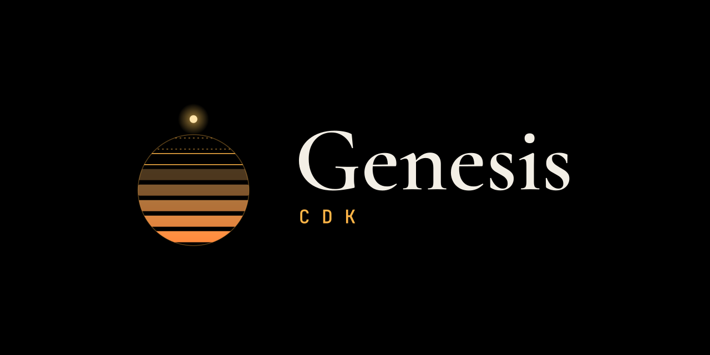

##### _In the beginning, the cloud was formless and empty._
##### _And God said, "Let there be stacks" and there were stacks._
##### _And God saw that the stacks were good_

...

From nothing, CDK constructs that handle the full creation of a web app on AWS - so you can ship without building the world from scratch.

## Documentation

- [Getting Started](docs/guide/getting-started.md)
- [Root Site](docs/guide/root-site.md)
- [Sub Site](docs/guide/sub-site.md)
- [Backend](docs/guide/backend.md)
- [Cert Stack](docs/guide/cert-stack.md)
- [CI Role](docs/guide/ci-role.md)
- [API Reference](docs/api/index.md)
